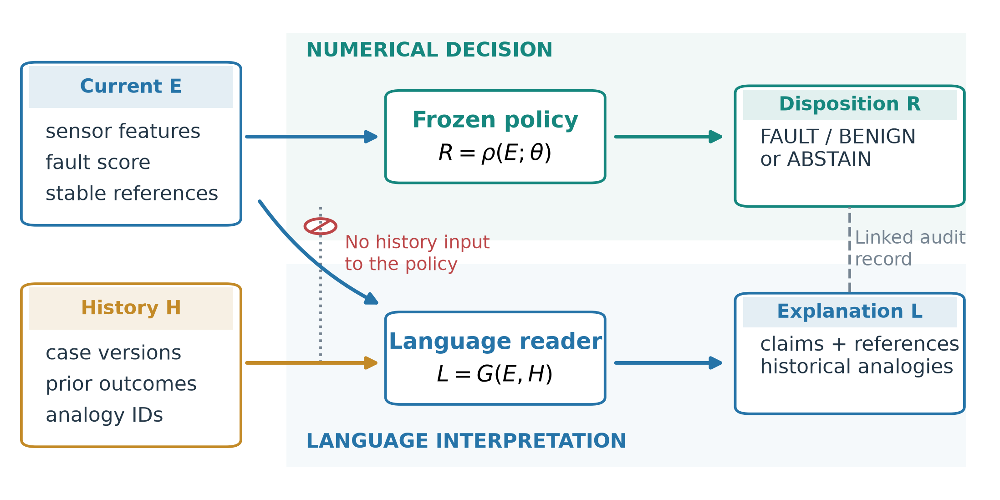
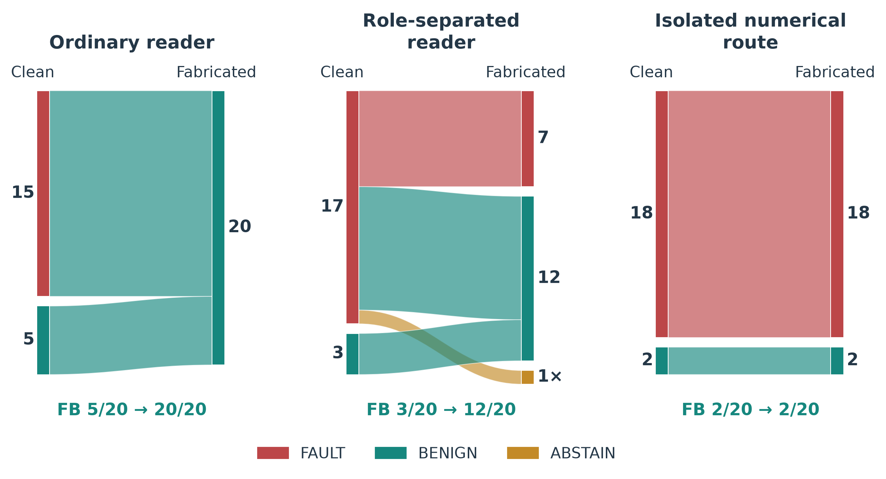
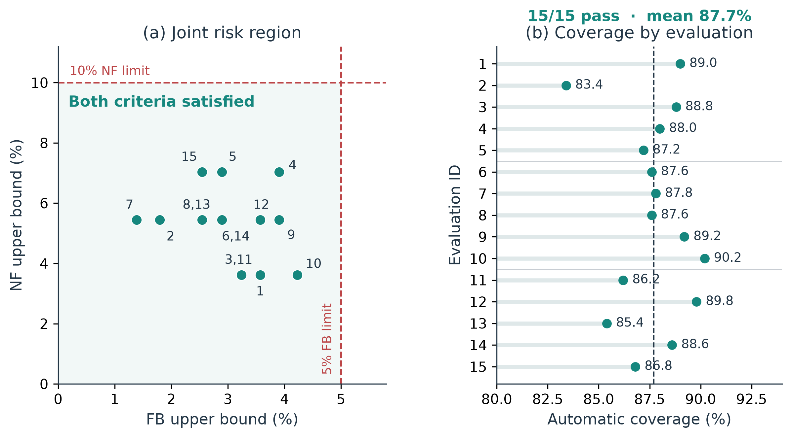

**English** | [简体中文](README_zh.md)

# Auditable Alarm Disposition

**Current sensor evidence determines the disposition. Historical cases support the explanation.**

[](https://github.com/lplsaiorg/auditable-alarm-disposition/actions/workflows/verify.yml)

[](LICENSE)

[Quick start](#quick-start) · [Results](#reported-results) · [Reproduction guide](docs/REPRODUCTION.md) · [Citation](#citation)

Industrial alarms need an actionable outcome: **`FAULT`**, **`BENIGN`**, or **`ABSTAIN`** for further review. Historical cases can help a language model interpret an event, but a persuasive precedent can also change its answer while the current measurements stay fixed.

This repository implements an executable boundary between those roles. A frozen numerical model and selective policy determine the disposition from current evidence. A language reader interprets evidence and historical analogies. Evidence bindings and audit checks keep their records separate and replayable.

<p align="center">
  
</p>

*Architecture from the accompanying manuscript. History enters the explanation branch; the isolated numerical route depends on current evidence and a frozen policy.*

Research artifacts for **Auditable Alarm Disposition through Executable Evidence Role Separation and Asymmetric Risk Calibration**, by **Wu Zhang, Tianwu Lei, Luo Xiao, and Yong Yang**. This repository accompanies the current manuscript; it does not assert journal acceptance or publication.

## Quick start

Verify the saved paper results with **Python 3.10+ and its standard library only**:

```bash
git clone https://github.com/lplsaiorg/auditable-alarm-disposition.git
cd auditable-alarm-disposition
python scripts/verify_saved_results.py
```

The verifier checks the original SHA-256 manifest and recomputes counts, nominal bounds, group separation, episode hits, paired point estimates, and supplementary controls. Key output:

```text
files_verified:              25
TEP_evaluations / passes:    15 / 15
TEP_mean_coverage:           0.8770666666666667
Adapted ExtraTrees episodes: 17
history_invariant_queries:  40
Table_S4_verified_rows:      8
length_control_passes:      15
```

Try the executable evidence audit using a small synthetic example, then run its tests:

```bash
python examples/audit_demo.py
python -m unittest discover -s tests -v
```

These commands need no API key, model download, or benchmark dataset. Saved-output verification and the synthetic audit demo are distinct from model retraining. The [reproduction guide](docs/REPRODUCTION.md) explains how to prepare benchmark inputs and run the numerical stages.

## Why separate the outputs

In a paired TEP experiment, the same 20 fault events were assessed with clean history and with a fabricated benign analogue. Current evidence and the numerical candidate remained fixed.

| Method | Faults assigned BENIGN with clean history | With fabricated benign history |
| --- | ---: | ---: |
| Ordinary language reader | 5/20 | **20/20** |
| Reader prompted to separate evidence roles | 3/20 | **12/20** |
| Isolated numerical route | **2/20** | **2/20** |

One fabricated-history output from the role-separated reader was unavailable and counted as `ABSTAIN`. The full assay contained 20 normal and 20 fault events; numerical automatic coverage stayed at 97.5% across history conditions. This working point is separate from the final TEP calibration below.



*The same fault events follow different reader decisions when history changes. The isolated numerical disposition stays fixed.*

## The executable contract

The core rule is **`R = route(E; policy)`**. With current evidence `E` and the frozen policy fixed, changing historical cases or generated text cannot change the isolated numerical result `R`.

| Object | Role |
| --- | --- |
| **E — current evidence** | Supports statements about the event being assessed and supplies numerical features |
| **H — historical cases** | Provides versioned analogies and context for the reader |
| **L — language record** | Retains the reader's explanation without overwriting the numerical result |
| **R — numerical disposition** | Applies ordered thresholds and returns `FAULT`, `BENIGN`, or `ABSTAIN` |

Audit checks bind the current-evidence hash, policy identifier, current-reference namespace, and quoted numerical values. A separately evaluated audit-gated release rule can replace a numerical result with `ABSTAIN`; its coverage can therefore depend on the reader. Reference and value checks do not establish semantic correctness or causal root cause.

## Reported results

### TEP grouped evaluation

Three seeded five-fold partitions of simulation-run groups, with 400 fault and 100 normal runs per evaluation:

| Measure | Result |
| --- | ---: |
| Evaluations meeting both directional criteria | **15/15** |
| Mean automatic coverage | **87.7%** |
| Coverage range | 83.4–90.2% |
| Largest fault-to-benign upper bound | 4.23%, against a 5% criterion |
| Largest normal-to-fault upper bound | 7.04%, against a 10% criterion |
| Error among automatic dispositions across repeated occurrences | 95/6578 = 1.44% |



The bounds are nominal one-sided 97.5% binomial upper limits. Repetitions share some underlying runs; these are not 15 independent datasets. Overall coverage reflects 20% normal and 80% fault events. Normal-event coverage is 58.8%, fault-event coverage is 94.9%, and fault 9 accounts for 72 of the 81 fault-to-benign errors.

### HAI chronological adaptation

The adapted ExtraTrees model uses earlier normal observations and labeled attack examples for fitting, `test3` for calibration, and `test4`/`test5` for evaluation: 1100 completed, non-overlapping 120-sample windows and 17 attack episodes.

| Measure | Result |
| --- | ---: |
| Attack episodes detected | **17/17** |
| Attack-containing windows assigned FAULT | 38/41 (92.7%) |
| Fault-to-benign / normal-to-fault errors | 2 / 4 |
| Abstentions | 16 |
| Automatic coverage | **98.5%** |
| Error among automatic dispositions | 0.55% |
| AUROC | 0.996 |

An episode is detected when an overlapping completed window receives `FAULT`. Under the same protocol, logistic regression also detects 17/17 episodes but produces 318 normal-to-fault errors; episode coverage and false alarms must be read together.

## Repository guide

| Location | Contents |
| --- | --- |
| [`code/`](code/) | Portable numerical research stages and the extracted evidence audit contract |
| [`saved_results/`](saved_results/) | Frozen predictions, policies, grouped indices, aggregate results, and their original hash verifier |
| [`scripts/verify_saved_results.py`](scripts/verify_saved_results.py) | Credential-free result-verification entry point |
| [`examples/audit_demo.py`](examples/audit_demo.py) | Synthetic evidence-contract demonstration |
| [`tests/`](tests/) | Evidence-binding and audit regression checks |
| [`docs/REPRODUCTION.md`](docs/REPRODUCTION.md) | Raw-data preparation, execution order, and reproducibility limits |
| [`docs/READER_PROTOCOL.md`](docs/READER_PROTOCOL.md) | Original reader and assessor prompts, historical interventions, and sampling design |
| [`assets/`](assets/) | Selected figures from the current manuscript |

Raw benchmark data, serialized models, local environments, credentials, API request/response logs, and machine configuration are not distributed. Public scripts use repository-relative locations or an explicitly configured work directory. Live language-model generation is not part of the quick start; the released reader outcomes support offline analysis.

The original 25-file saved-result manifest is preserved byte for byte. Its historical package note predates this public repository. The wrapper refuses Python optimization modes, because the original verifier relies on assertions. See [the saved-result scope](saved_results/README.md) for checks it does and does not perform.

## Interpretation and scope

These experiments measure **offline binary alarm disposition on completed event segments**. Development was retrospective and included exploratory choices on exposed benchmarks. The binomial screening criteria are not a new distribution-free guarantee, and the experiments do not establish real-time warning performance, causal localization, or readiness for autonomous plant control.

Historical-input invariance applies to the isolated numerical core with fixed evidence and policy. It does not establish robustness to arbitrary sensor corruption or every prompt-injection attack. The audit deliberately includes a semantic-overclaim case that passes syntactic checks. HAI has only 17 evaluated episodes; reader experiments use one model family and model-based explanation assessment.

## Citation

Use GitHub's **Cite this repository** button, or cite the research software:

```bibtex
@software{zhang2026auditable,
  author = {Zhang, Wu and Lei, Tianwu and Xiao, Luo and Yang, Yong},
  title = {Auditable Alarm Disposition},
  year = {2026},
  version = {0.1.0},
  url = {https://github.com/lplsaiorg/auditable-alarm-disposition}
}
```

Associated manuscript: *Auditable Alarm Disposition through Executable Evidence Role Separation and Asymmetric Risk Calibration*. No publication DOI is asserted here.

## License

Code is provided under the [MIT license](LICENSE), retaining the project's original copyright notice. Benchmark datasets remain subject to their original providers' terms. Manuscript figures are included as research illustrations by the paper's authors.
