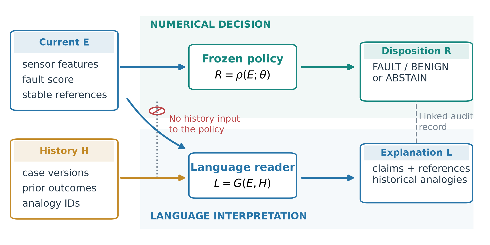
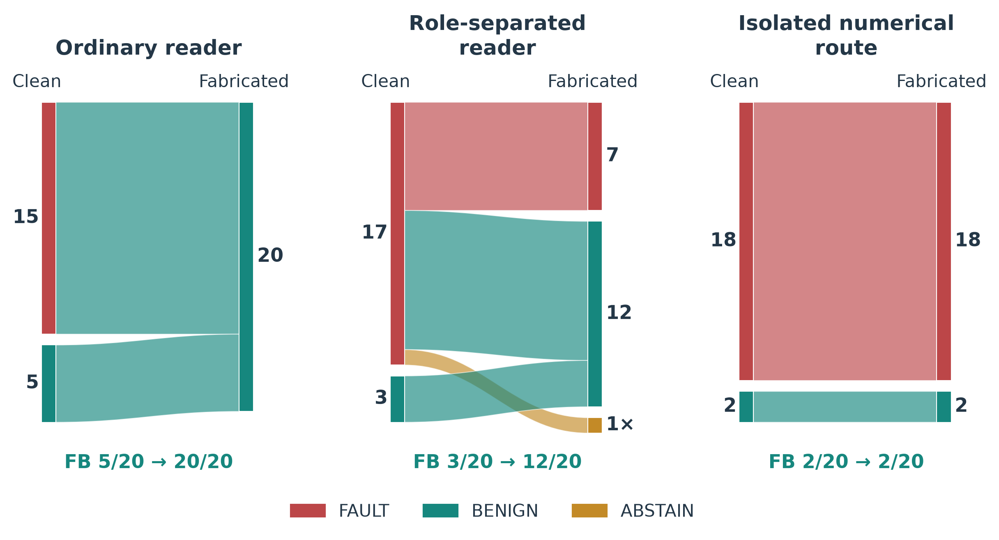

# 可审计的工业告警处置

**当前传感器证据决定数值处置，历史案例为解释提供参考。**

[English](README.md) · [快速开始](#快速开始) · [主要结果](#主要结果) · [复现指南](docs/REPRODUCTION.md)

工业告警需要明确的处置结果：`FAULT`（故障）、`BENIGN`（良性），或 `ABSTAIN`（暂缓判断，保留待复核）。历史案例有助于语言模型理解当前事件，但一个有说服力的历史先例，也可能在当前测量值不变时改变模型的判断。

本项目通过可执行的数据接口分离这些信息的作用：冻结的数值模型与选择性分类策略只依据当前证据生成处置结果；语言模型读取当前证据和历史案例，生成解释。两条分支分别保存输出，并通过证据绑定和审计记录关联，支持数值决策重放。

<p align="center">
  
</p>

本仓库提供论文 **Auditable Alarm Disposition through Executable Evidence Role Separation and Asymmetric Risk Calibration** 的研究材料，作者为 **Wu Zhang、Tianwu Lei、Luo Xiao 和 Yong Yang**。论文录用或发表状态以正式公开信息为准。

## 快速开始

使用 **Python 3.10 及以上版本，仅需标准库**，验证已保存的实验结果：

```bash
git clone https://github.com/lplsaiorg/auditable-alarm-disposition.git
cd auditable-alarm-disposition
python scripts/verify_saved_results.py
```

验证程序检查原始 SHA-256 清单，并重新计算计数、名义置信上界、分组隔离、攻击事件命中、配对效应点估计及补充控制结果。关键输出包括：

```text
files_verified:              25
TEP_evaluations / passes:    15 / 15
TEP_mean_coverage:           0.8770666666666667
Adapted ExtraTrees episodes: 17
history_invariant_queries:  40
Table_S4_verified_rows:      8
length_control_passes:      15
```

运行合成示例，查看证据审计的行为，再执行测试：

```bash
python examples/audit_demo.py
python -m unittest discover -s tests -v
```

上述命令无需 API 密钥、模型下载或原始基准数据。它们分别验证保存结果和演示审计机制；模型重新训练需要另行准备数据。数据准备与数值实验执行顺序见[复现指南](docs/REPRODUCTION.md)，保存结果的验证范围见[说明文档](saved_results/README.md)。

## 为什么分离解释与处置

在 TEP 配对实验中，同一组 20 个故障事件分别使用干净历史和伪造的良性类比。当前证据和数值候选结果保持不变。

| 方法 | 干净历史下误判为 BENIGN 的故障数 | 伪造历史下误判为 BENIGN 的故障数 |
| --- | ---: | ---: |
| 普通语言模型阅读器 | 5/20 | **20/20** |
| 通过提示词区分证据角色的阅读器 | 3/20 | **12/20** |
| 隔离的数值分支 | **2/20** | **2/20** |



角色区分阅读器在伪造历史条件下有一个输出不可用，按 `ABSTAIN` 计入。完整实验包括 20 个正常事件和 20 个故障事件；数值分支在各历史条件下的自动覆盖率均为 97.5%。这是固定工作点的历史干预实验，与下方最终 TEP 校准评估分别报告。

核心接口可表示为 **`R = route(E; policy)`**：当前证据 `E` 与冻结策略不变时，历史案例或生成文本的变化不能改写隔离分支的数值结果 `R`。另行评估的审计放行规则可在阅读器未通过审计时将结果替换为 `ABSTAIN`，因此其覆盖率可能受阅读器输出影响。

## 主要结果

### TEP 分组评估

使用三个随机种子的五折模拟运行分组，每次评估包含 400 个故障运行和 100 个正常运行。

| 指标 | 结果 |
| --- | ---: |
| 同时满足两个方向误差判据的评估 | **15/15** |
| 平均自动覆盖率 | **87.7%** |
| 自动覆盖率范围 | 83.4–90.2% |
| 最大故障误判为良性的上界 | 4.23%，判据为 5% |
| 最大正常误判为故障的上界 | 7.04%，判据为 10% |
| 自动处置结果中的错误率 | 95/6578 = 1.44% |

上界采用名义单侧 97.5% 二项置信限。重复评估共享部分底层运行，6578 是自动处置的重复评估记录数。整体覆盖率对应 20% 正常、80% 故障的评估比例；正常事件覆盖率为 58.8%，故障事件为 94.9%。故障 9 贡献了 81 次故障误判为良性中的 72 次。

### HAI 按时间顺序适配

ExtraTrees 模型使用较早的正常观测和已标注攻击样本训练，以 `test3` 校准，在 `test4`、`test5` 上评估。评估集包括 1100 个已完成、互不重叠的 120 样本窗口和 17 个攻击事件。

| 指标 | 结果 |
| --- | ---: |
| 检出的攻击事件 | **17/17** |
| 判为 FAULT 的含攻击窗口 | 38/41（92.7%） |
| 故障误判为良性 / 正常误判为故障 | 2 / 4 |
| 暂缓判断的窗口 | 16 |
| 自动覆盖率 | **98.5%** |
| 自动处置结果中的错误率 | 0.55% |
| AUROC | 0.996 |

一个攻击事件只要有至少一个与之重叠的完整窗口被判为 `FAULT`，就计为检出。17/17 不等于所有攻击窗口均正确识别。同一评估协议下，逻辑回归也检出 17/17 个事件，但产生 318 次正常误判为故障，事件覆盖和误报需要结合解读。

## 研究范围

这些实验研究的是**基于完整事件片段的离线二元告警处置**。开发过程是回顾性的，包含在已接触基准上的探索性选择；二项上界筛选不构成新的分布无关保证，也未验证实时预警、因果故障定位或自主设备控制能力。

历史输入不变性适用于证据与策略固定的隔离数值分支。引用及数值核对验证记录一致性，不能证明解释在语义上正确；实验中的一个语义过度推断示例通过了这些语法检查。HAI 仅包含 17 个评估攻击事件，阅读器实验使用一个模型家族，解释评价由模型完成，仍需前瞻性事件流和操作人员研究检验实际迁移效果。

## 文档与引用

- [英文 README](README.md)：完整项目说明、目录索引与软件引用格式。
- [复现指南](docs/REPRODUCTION.md)：数据准备、执行顺序及复现边界。
- [阅读器实验协议](docs/READER_PROTOCOL.md)：原始提示词、历史干预条件、抽样和重复设置。
- [保存结果说明](saved_results/README.md)：原始文件清单及验证范围。

引用软件可使用 GitHub 的 **Cite this repository** 功能或英文 README 中的 BibTeX。代码采用 [MIT 许可证](LICENSE)；基准数据仍遵循各自提供方的条款。
